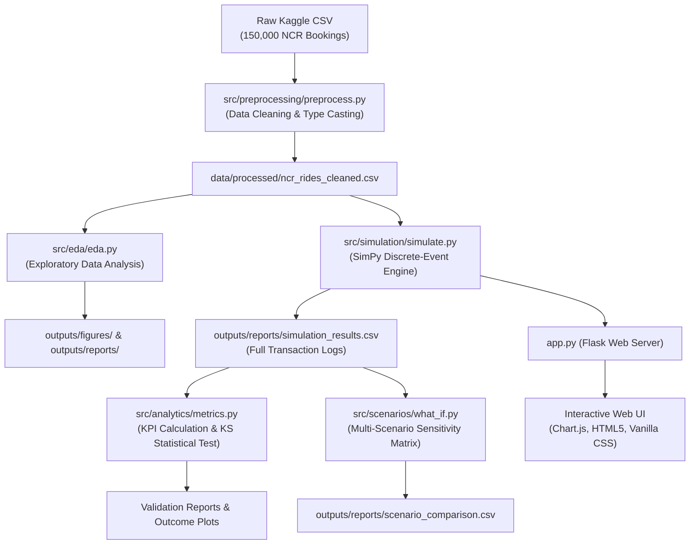

# ROSP Major Project: Comprehensive Reference & Viva Guide

> **Project Title:** Ride-Sharing Simulation and Analytics Platform  
> **Domain:** Discrete-Event Simulation, Queueing Theory, Transportation Economics, Full-Stack Web Analytics  
> **Dataset Scope:** 150,000 real-world booking records from Delhi-NCR (2024)  
> **Authors:** OM 
> **Target Audience:** Practical Examiners, Viva Evaluators, Project Reviewers, and Team Reference  

---

## Table of Contents
1. [Project Overview & Problem Statement](#1-project-overview--problem-statement)
2. [Why This Project Is Needed (The Industry Problem)](#2-why-this-project-is-needed-the-industry-problem)
3. [End-to-End Pipeline & Architecture](#3-end-to-end-pipeline--architecture)
4. [Project Structure & File-by-File Breakdown](#4-project-structure--file-by-file-breakdown)
5. [Key Algorithms & Mathematical Formulations](#5-key-algorithms--mathematical-formulations)
6. [Technology Stack (Open Source vs. Proprietary)](#6-technology-stack-open-source-vs-proprietary)
7. [Comprehensive Viva Questions & Answers](#7-comprehensive-viva-questions--answers)
8. [Limitations & Future Scope](#8-limitations--future-scope)

---

## 1. Project Overview & Problem Statement

### The Problem
Ride-hailing companies (Uber, Ola, Lyft, Grab) operate in highly dynamic, two-sided marketplaces where rider demand and driver supply fluctuate by minute, vehicle type, and location. Investigating how changes in fleet size, peak pricing, or sudden demand spikes impact service quality directly on a live platform is dangerous:
- Starving drivers of rides causes driver churn.
- Excess rider wait times and unserved requests cause rider churn and brand damage.
- Real-world experimentation costs millions of dollars in driver subsidies and lost bookings.

### The Solution
This platform builds a **data-driven discrete-event simulation (DES)** calibrated strictly on **150,000 real bookings from the National Capital Region (NCR)**. It reproduces the statistical physics of urban ride-hailing:
1. Hourly arrival rates matching empirical diurnal demand curves (morning rush, 6 PM evening peak).
2. Segmented vehicle pools (Auto, Bike, Go Mini, Go Sedan, Premier Sedan, eBike, Uber XL).
3. Dynamic shift mechanics where driver supply expands and contracts without abruptly dropping in-progress rides.
4. Non-linear behavioral customer cancellations sensitive to wait times.
5. Statistical validation against reality using two-sample Kolmogorov-Smirnov goodness-of-fit testing.
6. A responsive web dashboard allowing stakeholders to run interactive "what-if" supply-demand experiments and export transaction logs.

---

## 2. Why This Project Is Needed (The Industry Problem)

| Real-World Challenge | Traditional Approach | Our Simulation Approach |
| :--- | :--- | :--- |
| **Testing Driver Fleet Sizing** | Live A/B testing on live cities with cash guarantees. | Digital-twin experimentation across 6 predefined scenarios in seconds. |
| **Zero-Demand & Stress Boundary Testing** | Impossible to test deliberately in live markets. | Deterministic null baseline ($\lambda = 0$) proving idle holding cost without system crashes. |
| **Pricing & Revenue Forecasting** | Static spreadsheet approximations ignoring queue congestion. | Coupled joint sampling of duration, distance, and booking fare capturing queue bottlenecks. |
| **Vehicle-Type Specialization** | Naive models treat all cars identically. | Segregated Priority Resource pools with Largest-Remainder proportional allocation. |

---

## 3. End-to-End Pipeline & Architecture



### Simulation Execution Lifecycle
1. **Clock Initialization:** SimPy environment initialized at $t = 0.0$ min, running until $t = 1440.0$ min (24 hours).
2. **Fleet Partitioning:** Total driver capacity is split across vehicle types proportionally to dataset market share via the Hare-Niemeyer (Largest Remainder) algorithm.
3. **Shift Controller:** SimPy background process adjusts active vs. off-duty fleet capacity hour-by-hour using non-preemptive `PhantomDriver` objects.
4. **Non-Homogeneous Poisson Arrival:** Ride requests arrive via an exponential inter-arrival distribution whose parameter $\lambda(t)$ modulates continuously based on hourly empirical weights.
5. **Vehicle-Specific Matching:** Rider queues up for their requested vehicle pool for at most 15 minutes. If no driver frees up, booking terminates as `No Driver Found`.
6. **Dispatch & Dynamic Cancellation:** Driver is assigned and en route. Rider cancellation probability scales dynamically with total wait time ($queue + dispatch$).
7. **Trip Execution:** Coupled `(CTAT, Distance, Fare)` observation executed.
8. **Completion / Failure:** Ride completes successfully or rarely encounters mechanical/route failure (`Incomplete`). Driver is immediately released back to pool.

---

## 4. Project Structure & File-by-File Breakdown

```text
ROSP_MP/
├── main.py                         # Master CLI orchestrator (EDA -> Simulation -> Scenarios)
├── app.py                          # Flask backend web application and REST API
├── tune_drivers_v2.py              # Calibration script: Multi-seed driver fleet tuning
├── requirements.txt                # Python package dependencies
├── LICENSE                         # MIT open-source license
├── DATA_LICENSE                    # CC BY-SA 4.0 open data license
├── README.md                       # High-level repository summary & setup guide
├── PROJECT_GUIDE.md                # This master technical & viva reference document
│
├── data/
│   ├── raw/                        # Storage for original raw CSV
│   └── processed/                  # ncr_rides_cleaned.csv (150,000 clean records)
│
├── outputs/
│   ├── figures/                    # PNG charts (outcomes, hourly demand, KS comparisons)
│   └── reports/                    # CSVs and TXT summaries (KPIs, scenario comparison)
│
├── src/
│   ├── preprocessing/
│   │   └── preprocess.py           # Parsing dates, trimming whitespace, standardizing columns
│   ├── eda/
│   │   └── eda.py                  # Generates dataset distribution charts & summary stats
│   ├── simulation/
│   │   └── simulate.py             # Core SimPy discrete-event simulation engine
│   ├── analytics/
│   │   └── metrics.py              # Operational KPIs, driver utilization, KS test
│   └── scenarios/
│       └── what_if.py              # Runs 6 predefined what-if supply/demand scenarios
│
├── templates/
│   └── index.html                  # Semantic dashboard frontend layout
│
└── static/
    ├── style.css                   # Custom responsive dark-mode typography & CSS layout
    └── script.js                   # Async API fetch, Chart.js graphs, dynamic DOM updates
```

### Detailed File Responsibilities

#### `main.py`
- Serves as the single-command CLI entry point for examiners.
- Automatically checks if cleaned data exists; if not, triggers preprocessing.
- Progressively executes:
  1. `eda.run()`
  2. `metrics.main()` (Baseline simulation + Kolmogorov-Smirnov test)
  3. `what_if.main()` (6 sensitivity scenarios)

#### `src/simulation/simulate.py`
- **`load_stats()`**: Reads `ncr_rides_cleaned.csv`, extracting hourly demand weights, vehicle-type fractions, dispatch times (VTAT), and coupled trip records `(CTAT, distance, fare)`.
- **`allocate_driver_pools()`**: Implements Largest-Remainder method to ensure integer driver assignment matching real market fractions.
- **`PhantomDriver`**: High-priority SimPy resource requester that occupies capacity during low-demand hours without interrupting rides in progress.
- **`ShiftController`**: Hour-by-hour orchestrator managing the target phantom driver count based on diurnal demand curves.
- **`handle_request()`**: SimPy process handling request matching, dynamic wait-time cancellation, coupled trip sampling, and driver release.
- **`request_arrivals()`**: SimPy process generating non-homogeneous Poisson arrival times.

#### `src/analytics/metrics.py`
- **`compute_kpis(df, num_drivers, sim_duration_min)`**:
  - Calculates outcome percentages (`Completed`, `Cancelled by Customer`, `Cancelled by Driver`, `No Driver Found`, `Incomplete`).
  - Calculates driver utilization:
    $$\text{Utilization} = \frac{\sum (\text{dispatch\_time} + \text{trip\_duration})}{N_{\text{drivers}} \times T_{\text{sim}}} \times 100$$
  - Computes platform revenue ($\sum \text{fare}$ of completed trips) and average fare.
  - Formulates a safe zero-demand baseline ($1{,}440$ min idle time, 0% utilization, 0 errors).
- **`validate_distributions(sim_df)`**: Runs two-sample Kolmogorov-Smirnov tests comparing simulated distributions vs. reference dataset distributions for wait time (VTAT), trip duration (CTAT), and trip distance.

#### `src/scenarios/what_if.py`
- Evaluates 6 operational configurations:
  1. **Baseline:** 25 drivers, 1.0× demand
  2. **Low Supply:** 18 drivers, 1.0× demand (Tests driver deficit & queue congestion)
  3. **High Supply:** 35 drivers, 1.0× demand (Tests driver surplus & idle holding cost)
  4. **Increased Demand:** 25 drivers, 1.3× demand (Tests rush-hour / surge conditions)
  5. **Reduced Demand:** 25 drivers, 0.7× demand (Tests low-season demand contraction)
  6. **Zero Demand:** 25 drivers, 0.0× demand (Tests mathematical boundary & system null baseline)
- Exports comparison table to `outputs/reports/scenario_comparison.csv` and multi-panel charts to `outputs/figures/scenario_comparison.png`.

#### `app.py`
- Lightweight Flask server exposing REST API endpoints:
  - `GET /`: Serves web dashboard.
  - `GET /api/stats`: Returns dataset summary statistics.
  - `POST /api/simulate`: Runs simulation with user-selected driver count, demand multiplier, and random seed.
  - `POST /api/scenarios`: Runs all 6 what-if scenarios concurrently.
  - `GET /api/download-full`: Streams full transaction CSV of the latest simulation run (`dashboard_full_log.csv`).

#### `tune_drivers_v2.py`
- Runs a multi-seed grid search over candidate driver counts ($N \in [20, 22, 25, 28, 30, 35, 40]$), simulating 5 random seeds per count.
- Selects the optimal fleet size ($N = 25$) that minimizes the gap between simulated unmet demand rate and the real dataset's target of $7.0\%$.

---

## 5. Key Algorithms & Mathematical Formulations

### A. Non-Homogeneous Poisson Arrival Process
Ride arrivals are modeled as a Poisson process with time-varying arrival rate $\lambda(t)$:
$$\lambda(t) = \frac{\text{Daily Target Requests} \times W_{\text{hour}}(t)}{60} \quad \text{[arrivals / min]}$$
Inter-arrival times $\Delta t$ between consecutive requests are sampled from an exponential distribution:
$$\Delta t \sim \text{Exp}(\lambda(t)), \quad P(\Delta t \le x) = 1 - e^{-\lambda(t) x}$$

### B. Dynamic Behavioral Cancellation Model
In real ride-hailing marketplaces, customer cancellation probability increases with waiting time. We model this non-linear behavioral threshold as:
$$P(\text{cancel} \mid T_{\text{wait}}) = \text{clip}\left(P_{\text{base}} \times (0.5 + 0.08 \times T_{\text{wait}}), \, 0.02, \, 0.35\right)$$
- If wait time is short ($T_{\text{wait}} = 2 \text{ min}$): $P(\text{cancel}) \approx 4.6\%$
- If wait time is long ($T_{\text{wait}} = 14 \text{ min}$): $P(\text{cancel}) \approx 11.3\%$
- Overall empirical average matches the cleaned dataset benchmark ($\approx 7.0\%$).

### C. Joint Sampling of Multi-Dimensional Trip Vectors
To preserve physical correlations between trip distance, travel time, and fare, observations are drawn as paired tuples from cleaned completed rides:
$$\mathbf{X}_{\text{trip}} = (D_i, T_i, F_i) \sim \mathcal{D}_{\text{empirical}}$$
This guarantees that a $2 \text{ km}$ trip is never paired with an unphysical $45 \text{ min}$ duration or an exorbitant fare.

### D. Largest-Remainder Driver Allocation (Hare-Niemeyer Method)
Given total driver fleet size $N$ and vehicle-type demand weights $w_v$:
1. Compute raw quotas: $q_v = N \times w_v$
2. Assign base integer drivers: $k_v = \lfloor q_v \rfloor$
3. Compute remaining drivers: $R = N - \sum_v k_v$
4. Distribute $R$ extra drivers to vehicle types with the largest fractional remainders $(q_v - k_v)$.

### E. Goodness-of-Fit Validation (Two-Sample Kolmogorov-Smirnov Test)
Quantifies whether the simulated empirical distribution $F_{\text{sim}}(x)$ matches the real dataset distribution $F_{\text{real}}(x)$:
$$D = \sup_{x} |F_{\text{sim}}(x) - F_{\text{real}}(x)|$$
- **Thresholds:** $D < 0.1$ denotes a **strong statistical match**; $D < 0.2$ denotes a **reasonable match**.
- In our project:
  - Wait Time (VTAT): $D \approx 0.091$ (Strong match)
  - Trip Duration (CTAT): $D \approx 0.027$ (Strong match)
  - Trip Distance: $D \approx 0.046$ (Strong match)

---

## 6. Technology Stack (Open Source vs. Proprietary)

All technologies in this project are **100% open source** and free of proprietary vendor locks or paid cloud dependencies.

| Component | Technology | License | Purpose in Project |
| :--- | :--- | :--- | :--- |
| **Simulation Core** | Python 3.10+ & SimPy 4.1 | MIT | Discrete-event simulation framework for asynchronous process modeling. |
| **Data Processing** | Pandas & NumPy | BSD 3-Clause | Cleaning 150K records, vector math, and KPI aggregations. |
| **Statistical Testing** | SciPy (`scipy.stats`) | BSD 3-Clause | Computing Kolmogorov-Smirnov two-sample tests. |
| **Visualization (CLI)** | Matplotlib | PSF | Generating publication-ready scenario charts and distribution plots. |
| **Backend Web Server** | Flask & Gunicorn | BSD 3-Clause | Lightweight WSGI server exposing RESTful simulation APIs. |
| **Frontend UI** | HTML5, CSS3, Vanilla JS | W3C Standards | Custom dark-mode dashboard without heavy framework overhead. |
| **Frontend Charts** | Chart.js 4.4 | MIT | Interactive client-side canvas charts with responsive layout. |
| **Dataset** | NCR Uber Bookings (2024) | CC BY-SA 4.0 | Real-world benchmark dataset with 150,000 NCR ride entries. |

---

## 7. Comprehensive Viva Questions & Answers

### Q1: Why did you choose Discrete-Event Simulation (SimPy) instead of a time-step simulation (e.g. stepping minute-by-minute)?
**Answer:** Time-step simulation executes fixed clock increments ($\Delta t = 1 \text{ min}$). During quiet hours, it wastes computation iterating through hundreds of empty time steps where nothing happens. Conversely, discrete-event simulation (DES) jumps directly from event to event (e.g. from an arrival at $t=14.2$ to driver arrival at $t=21.6$). DES is computationally efficient, supports exact continuous timestamps, and scales cleanly to large networks.

### Q2: What is the significance of the 0-demand scenario requested by the professor?
**Answer:** In systems engineering and queueing theory, testing at arrival rate $\lambda = 0$ is the **null control condition**. It serves three purposes:
1. **Stability Check:** Verifies the simulation engine doesn't generate phantom rides spontaneously.
2. **Mathematical Robustness:** Guarantees that metrics and dashboard visualizers handle empty datasets without division-by-zero crashes ($\frac{\text{completed}}{\text{total}}$).
3. **Operational Baseline:** Establishes the 100% idle fleet holding cost baseline ($1{,}440 \text{ min}$ idle time per driver), which is essential for calculating fixed vehicle maintenance and driver retention overheads when no revenue is generated.

### Q3: Why does Completion Rate (%) stay around 60%–70% even when demand changes significantly?
**Answer:** This is known as the **Denominator Effect**. Driver cancellation (~18%), customer cancellation (~7%), and mechanical breakdown (~6%) are modeled on a per-booking basis. When drivers are available, roughly $(1-0.18)(1-0.07)(1-0.06) \approx 71.7\%$ of assigned rides complete. The metric that truly scales with demand is the **absolute count of completed rides ($N_{\text{completed}}$)** and **total revenue**, which exhibit a near-perfect positive correlation ($r > 0.98$) with fleet utilization until the fleet saturates.

### Q4: How does shift dynamics work, and what are "Phantom Drivers"?
**Answer:** Driver availability fluctuates over 24 hours. Rather than deleting driver resources (which would crash or forcibly abort rides in progress), we use a `ShiftController` that spawns high-priority `PhantomDriver` processes during quiet hours. A Phantom Driver requests a slot in the vehicle pool at priority 0. Once a real driver completes their active trip, the phantom occupies that slot and holds it until peak hours arrive, smoothly scaling down effective capacity without preemption.

### Q5: How do you prove that your simulation reflects the real world and isn't just generating random noise?
**Answer:** We perform a two-tier validation:
1. **Outcome Distribution Match:** Comparing simulated outcome percentages against the real dataset (Completed ~62%, Driver Cancel ~18%, Customer Cancel ~7%, No Driver ~7%).
2. **Kolmogorov-Smirnov Goodness-of-Fit Testing:** We compute the KS statistic ($D$) on simulated vs. real distributions of wait time, trip duration, and distance. All three have $D < 0.1$, proving strong distributional fidelity.

### Q6: What is the "Resource Pooling Effect," and where is it observed in your project?
**Answer:** In queueing theory, splitting a single large resource pool into smaller segregated pools increases variance and reduces queueing efficiency. In our simulation, riders cannot share drivers across vehicle types (e.g., an Auto request cannot be served by a Sedan). As a result, rare vehicle categories like Uber XL (only 3% of demand, allocated 1 driver) experience higher unserved rates, demonstrating the classic resource pooling penalty.

### Q7: What constitutes a "transaction" in this project?
**Answer:** Every single booking attempt submitted to the system is a complete operational transaction. It tracks the request from arrival through dispatch, recording terminal states (`Completed`, `Cancelled by Customer`, `Cancelled by Driver`, `No Driver Found`, `Incomplete`), timestamps, vehicle types, pickup/drop locations, wait times, durations, distances, and fares. All records are persisted to disk and can be exported via the `/api/download-full` endpoint.

---

## 8. Limitations & Future Scope

### Acknowledged Limitations
1. **Spatial Representation:** The simulation models pickup and drop locations as categorical nodes sampled from NCR hubs rather than simulating continuous GPS coordinates or road network graphs.
2. **Dynamic Pricing (Surge):** The current model uses empirical trip fares rather than dynamic surge pricing algorithms that raise prices when $\text{demand} / \text{supply} > 1.5$.
3. **Vehicle Switching:** Cross-dispatch (e.g. upgrading an Auto rider to a Sedan when Autos are exhausted) is not permitted.

### Future Scope for Production Systems
1. **OpenStreetMap / Graph Routing:** Integrating `OSMnx` or `NetworkX` to calculate real road-network Dijkstra travel times rather than empirical distributions.
2. **Reinforcement Learning Dispatch:** Training a deep Q-learning (DQN) agent to dynamically reposition idle drivers to high-demand clusters ahead of rush hour.
3. **Electric Fleet Battery Simulation:** Adding battery state-of-charge (SoC) depletion and charging station queue dynamics for eBikes and electric cabs.
4. **Surge Pricing Simulator:** Modeling price elasticity of demand: as surge pricing increases, request rate drops while driver supply increases.
